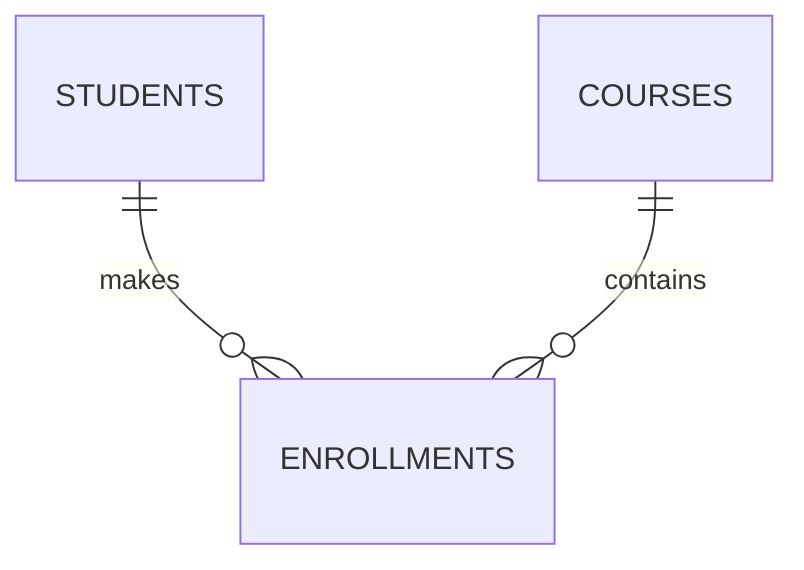

# Student Registration & Grading System – Oracle PL/SQL

| | |
|---|---|
| **Course** | Database Development with PL/SQL (INSY 8311) |
| **Instructor** | Eric Maniraguha |
| **Teaching Assistant** | Afanyu Emmanuel |
| **Group Assignment** | IV |

---

## 1. Group Members

| Full Name | Student ID | Contributions |
|---|---|---|
| MUGISHA Yves | 20251SEN202 |  |
| BWIZA Janviere | 20251SEN243 |  |

---

## 2. Application Description

A simple system for registering students in courses and managing their grades. It is built entirely with Oracle PL/SQL stored procedures and functions, and it handles errors in every operation.

### Functional Requirements

- Register a new student.
- Update a student's score in a course.
- Drop a student from a course.
- Print a student's transcript.
- Apply a grade curve to every student in a course at once.
- Calculate a student's GPA and convert scores to letter grades.
- Find a student by last name.

---

## 3. Database Schema

### Tables

| Table | Purpose |
|---|---|
| `students` | Student information |
| `courses` | Courses offered |
| `enrollments` | Links students to courses and stores each score |

### Relationships



- `students 1 — N enrollments N — 1 courses`

### Key Constraints

- **PRIMARY KEY** on every table.
- **FOREIGN KEY** from `enrollments` to `students` and `courses`.
- **UNIQUE** on `students.email` and on `enrollments (student_id, course_id)`.
- **CHECK**: `score BETWEEN 0 AND 100` and `credits > 0`.
- **NOT NULL** on required columns.

> Full definitions: [`00_schema/01_create_tables.sql`](00_schema/01_create_tables.sql)

---

## 4. PL/SQL Objects

### Stored Procedures (`01_procedures/`)

| File | Description | Parameters |
|---|---|---|
| `register_student.sql` | Inserts a new student and returns the new ID | IN: student details · OUT: `p_new_id` |
| `update_score.sql` | Updates a student's score in a course | IN: `p_student_id`, `p_course_id`, `p_score` |
| `drop_enrollment.sql` | Removes a student from a course | IN: `p_student_id`, `p_course_id` |
| `print_student_transcript.sql` | Prints a student's courses and scores | IN: `p_student_id` |
| `bulk_apply_curve.sql` | Adds curve points to every score in a course | IN: `p_course_id`, `p_points` |

### Stored Functions (`02_functions/`)

| File | Description | Returns |
|---|---|---|
| `get_student_gpa.sql` | Calculates a student's GPA | `NUMBER` |
| `get_letter_grade.sql` | Converts a score to a letter grade | `VARCHAR2` |
| `find_student_by_last_name.sql` | Finds a student by last name | `students%ROWTYPE` |

---

## 5. Requirements Coverage Map

| Concept | Where It Is Demonstrated |
|---|---|
| User-defined `RECORD` type | `print_student_transcript.sql` |
| `%ROWTYPE` record | `print_student_transcript.sql`, `find_student_by_last_name.sql` |
| Nested table | `bulk_apply_curve.sql` |
| VARRAY | `get_letter_grade.sql` |
| Implicit cursor – `INSERT` + `SQL%ROWCOUNT` | `register_student.sql` |
| Implicit cursor – `UPDATE` + `SQL%FOUND` / `SQL%NOTFOUND` | `update_score.sql` |
| Implicit cursor – `DELETE` + `SQL%ROWCOUNT` | `drop_enrollment.sql` |
| Explicit cursor – `OPEN` / `FETCH` / `CLOSE` | `print_student_transcript.sql` |
| `BULK COLLECT` | `bulk_apply_curve.sql` |
| `FORALL` + `SAVE EXCEPTIONS` | `bulk_apply_curve.sql` |
| `NO_DATA_FOUND` | `print_student_transcript.sql`, `get_student_gpa.sql` |
| `TOO_MANY_ROWS` | `find_student_by_last_name.sql` |
| `DUP_VAL_ON_INDEX` | `register_student.sql` |
| User-defined exception | `update_score.sql` |
| `RAISE_APPLICATION_ERROR` | `drop_enrollment.sql`, `get_letter_grade.sql` |
| Function called from SQL and from a PL/SQL block | `03_tests/test_success_cases.sql` |

---

## 6. Repository Structure

```
plsql-assignment4-20251SEN202-20251SEN243/
│
├── README.md                        # Group members, application description, how to run
├── .gitignore
├── 00_schema/
│   ├── 01_create_tables.sql         # Tables, relationships, constraints
│   └── 02_insert_sample_data.sql    # Sample data
├── 01_procedures/                   # One file per stored procedure
├── 02_functions/                    # One file per stored function
├── 03_tests/
│   ├── test_success_cases.sql       # Successful execution
│   └── test_error_cases.sql         # Exception handling
├── screenshots/                     # Output of each test case
└── docs/
    └── IMPLEMENTATION_NOTES.md      # Implementation and performance explanation
```

---

## 7. Prerequisites

- Oracle Database (XE or Oracle Live SQL)
- Oracle SQL Developer or SQL*Plus

---

## 8. How to Run

Enable output first:

```sql
SET SERVEROUTPUT ON;
```

Then run the scripts in this order:

1. `00_schema/01_create_tables.sql`
2. `00_schema/02_insert_sample_data.sql`
3. Compile every file in `01_procedures/`
4. Compile every file in `02_functions/`
5. Run `03_tests/test_success_cases.sql` and `03_tests/test_error_cases.sql`
6. Compare your output with the images in `screenshots/`

---

## 9. Testing

### Success Cases (`03_tests/test_success_cases.sql`)

| # | Test | Expected Result | Screenshot |
|---|---|---|---|
| 1 | Register a new student | Student inserted, new ID returned | [register_student_output.png](screenshots/test_success_cases/register_student_output.png) |
| 2 | Update a score | "1 row updated" message | [update_score_output.png](screenshots/test_success_cases/update_score_output.png) |
| 3 | Drop an enrollment | "1 row deleted" message | [drop_enrollment_output.png](screenshots/test_success_cases/drop_enrollment_output.png) |
| 4 | Print a transcript | Courses and scores listed | [transcript_output.png](screenshots/test_success_cases/transcript_output.png) |
| 5 | Apply a grade curve | Scores updated, row count shown | [bulk_curve_output.png](screenshots/test_success_cases/bulk_curve_output.png) |
| 6 | Get GPA and letter grade | Correct values returned | [gpa_and_grade_output.png](screenshots/test_success_cases/gpa_and_grade_output.png) |
| 7 | Find a student by last name | Student details shown | [find_student_output.png](screenshots/test_success_cases/find_student_output.png) |

### Error Cases (`03_tests/test_error_cases.sql`)

| # | Test | Expected Exception | Screenshot |
|---|---|---|---|
| 1 | Register a student with a duplicate email | `DUP_VAL_ON_INDEX` | [error_duplicate_email_output.png](screenshots/test_error_cases/error_duplicate_email_output.png) |
| 2 | Update the score of a non-existent enrollment | User-defined exception | [error_update_score_output.png](screenshots/test_error_cases/error_update_score_output.png) |
| 3 | Drop a non-existent enrollment | `RAISE_APPLICATION_ERROR` | [error_drop_enrollment_output.png](screenshots/test_error_cases/error_drop_enrollment_output.png) |
| 4 | Transcript for an unknown student | `NO_DATA_FOUND` | [error_no_data_found_output.png](screenshots/test_error_cases/error_no_data_found_output.png) |
| 5 | Find a last name shared by two students | `TOO_MANY_ROWS` | [error_too_many_rows_output.png](screenshots/test_error_cases/error_too_many_rows_output.png) |
| 6 | Curve that pushes some scores above 100 | `SAVE EXCEPTIONS` (failed rows reported, others updated) | [error_bulk_curve_output.png](screenshots/test_error_cases/error_bulk_curve_output.png) |
| 7 | Letter grade for a score above 100 | `RAISE_APPLICATION_ERROR` | [error_invalid_score_output.png](screenshots/test_error_cases/error_invalid_score_output.png) |

Screenshots are in `screenshots/test_success_cases/` and `screenshots/test_error_cases/`.

---

## 10. Implementation & Performance Notes

`BULK COLLECT` and `FORALL` reduce the number of switches between the PL/SQL engine and the SQL engine. A row-by-row loop switches once per row, while a bulk operation handles all rows in one switch, so it is much faster on large data. `SAVE EXCEPTIONS` lets valid rows succeed and reports the rows that failed.

See [`docs/IMPLEMENTATION_NOTES.md`](docs/IMPLEMENTATION_NOTES.md) for details.

---

## 11. AI Usage Statement

We used an AI assistant to:

- Research PL/SQL topics and help us understand some concepts.
- Help draft parts of the SQL and PL/SQL code.
- Review our documentation for grammar errors.

We ran and tested all the code ourselves, and both of us understand and can explain every part of it.

---

## 12. References

- Lecture 06 – PL/SQL Collections and Records
- Lecture 08 – Cursors: Implicit & Explicit
- Oracle Database PL/SQL Language Reference
