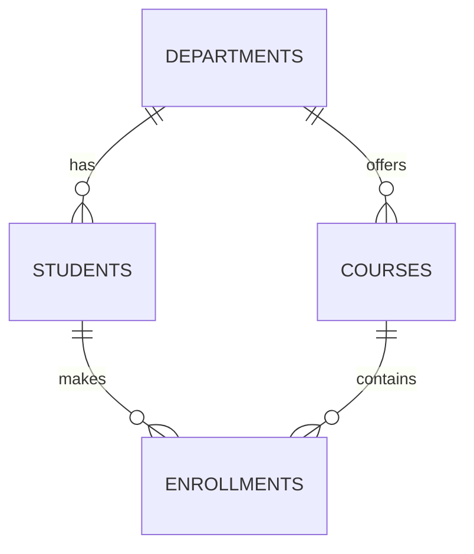

# Student Registration & Grading System – Oracle PL/SQL

| | |
|---|---|
| **Course** | Database Development with PL/SQL (INSY 8311) |
| **Instructor** | Eric Maniraguha |
| **Teaching Assistant** | Afanyu Emmanuel |
| **Group Assignment** | IV |

---

## 1. Group Members

| Full Name | Student ID | Contributions |
|---|---|---|
| MUGISHA Yves | 20251SEN202 |  |
|  | 20251SEN243 |  |

---

## 2. Application Description

The **Student Registration & Grading System** helps a university academic office manage students, courses, enrollments, and grades. Registrars use it to register students, enroll them in courses (one at a time or in bulk), record and adjust grades, and produce transcripts and GPA reports. All business logic is in Oracle PL/SQL stored procedures and functions, and every operation handles errors.

### Functional Requirements

- Register new students and update their contact details.
- Enroll students in courses, individually or in bulk.
- Drop a student's enrollment from a course.
- Record scores and convert them to letter grades.
- Apply a grade curve to every student in a course in one bulk operation.
- Calculate a student's GPA.
- Print a student's transcript and a course roster.
- List the top-performing students.
- Log failed bulk operations to an audit table instead of silently ignoring them.

---

## 3. Database Schema

### Tables

| Table | Purpose |
|---|---|
| `departments` | Academic departments that offer courses and host students |
| `students` | Student personal and academic information |
| `courses` | Courses offered, with credits and department |
| `enrollments` | Links students to courses and stores their score and grade |
| `grade_audit_log` | Records errors raised during bulk operations |

### Relationships



- `departments 1 — N students`
- `departments 1 — N courses`
- `students 1 — N enrollments N — 1 courses`

### Key Constraints

- **PRIMARY KEY** on every table.
- **FOREIGN KEY** from `students` and `courses` to `departments`, and from `enrollments` to `students` and `courses`.
- **UNIQUE** on `students.email` and on `enrollments (student_id, course_id)`, so a student cannot enroll in the same course twice.
- **CHECK**: `score BETWEEN 0 AND 100` and `credits > 0`.
- **NOT NULL** on required columns such as names, email, and course title.

> Full definitions: [`00_schema/01_create_tables.sql`](00_schema/01_create_tables.sql)

---

## 4. PL/SQL Objects

### Stored Procedures (`01_procedures/`)

| File | Description | Parameters |
|---|---|---|
| `register_student.sql` | Inserts a new student and returns the generated ID | IN: student details · OUT: `p_new_id` |
| `update_student_email.sql` | Updates a student's email | IN: `p_student_id`, `p_email` |
| `drop_enrollment.sql` | Removes a student from a course | IN: `p_student_id`, `p_course_id` |
| `print_student_transcript.sql` | Prints a student's courses, scores, and grades | IN: `p_student_id` |
| `list_course_roster.sql` | Prints all students enrolled in a course | IN: `p_course_id` |
| `bulk_enroll_students.sql` | Enrolls many students in a course in one operation | IN: `p_course_id`, `p_student_ids` (nested table) |
| `bulk_apply_curve.sql` | Adds curve points to every score in a course | IN: `p_course_id`, `p_points` |

### Stored Functions (`02_functions/`)

| File | Description | Returns |
|---|---|---|
| `get_student_gpa.sql` | Calculates a student's GPA from their enrollments | `NUMBER` |
| `get_letter_grade.sql` | Converts a numeric score to a letter grade | `VARCHAR2` |
| `get_top_students.sql` | Returns the top *N* students by GPA | Nested table type |
| `find_student_by_email.sql` | Looks up a student by email | `students%ROWTYPE` |

---

## 5. Requirements Coverage Map

| Concept | Where It Is Demonstrated |
|---|---|
| User-defined `RECORD` type | `list_course_roster.sql`, `get_top_students.sql` |
| `%ROWTYPE` record | `print_student_transcript.sql`, `find_student_by_email.sql` |
| Associative array (`INDEX BY`) | `bulk_apply_curve.sql` |
| Nested table | `bulk_enroll_students.sql`, `get_top_students.sql` |
| VARRAY | `get_letter_grade.sql` (grade bands) |
| Implicit cursor – `INSERT` + `SQL%ROWCOUNT` | `register_student.sql` |
| Implicit cursor – `UPDATE` + `SQL%FOUND` / `SQL%NOTFOUND` | `update_student_email.sql` |
| Implicit cursor – `DELETE` + `SQL%ROWCOUNT` | `drop_enrollment.sql` |
| Explicit cursor – `OPEN` / `FETCH` / `CLOSE` | `print_student_transcript.sql` |
| Explicit cursor – cursor `FOR` loop | `list_course_roster.sql` |
| `BULK COLLECT` (with `LIMIT`) | `bulk_apply_curve.sql`, `get_top_students.sql` |
| `FORALL` | `bulk_enroll_students.sql`, `bulk_apply_curve.sql` |
| `SAVE EXCEPTIONS` / `SQL%BULK_EXCEPTIONS` | `bulk_enroll_students.sql` |
| `NO_DATA_FOUND` | `print_student_transcript.sql`, `get_student_gpa.sql`, `find_student_by_email.sql` |
| `TOO_MANY_ROWS` | `find_student_by_email.sql` |
| `DUP_VAL_ON_INDEX` | `register_student.sql` |
| User-defined exception | `update_student_email.sql`, `bulk_apply_curve.sql` |
| `RAISE_APPLICATION_ERROR` | `drop_enrollment.sql`, `get_letter_grade.sql` |
| Function called from SQL | `03_tests/test_success_cases.sql` (`SELECT get_student_gpa(...) FROM dual`) |
| Function called from PL/SQL block | `03_tests/test_success_cases.sql` |

---

## 6. Repository Structure

```
plsql-assignment4-20251SEN202-20251SEN243/
│
├── README.md                        # Group members, application description, how to run
├── .gitignore
├── 00_schema/
│   ├── 01_create_tables.sql         # Tables, relationships, constraints
│   └── 02_insert_sample_data.sql    # Sample data
├── 01_procedures/                   # One file per stored procedure
├── 02_functions/                    # One file per stored function
├── 03_tests/
│   ├── test_success_cases.sql       # Successful execution
│   └── test_error_cases.sql         # Exception handling
├── screenshots/                     # Output of each test case
└── docs/
    └── IMPLEMENTATION_NOTES.md      # Implementation and performance explanation
```

---

## 7. Prerequisites

- Oracle Database 19c / 21c XE / 23ai (or Oracle Live SQL)
- Oracle SQL Developer or SQL*Plus
- A database user with `CREATE TABLE`, `CREATE SEQUENCE`, `CREATE PROCEDURE`, and `CREATE TYPE` privileges

---

## 8. How to Run

Enable output first:

```sql
SET SERVEROUTPUT ON;
```

Then run the scripts in this order:

1. `00_schema/01_create_tables.sql`
2. `00_schema/02_insert_sample_data.sql`
3. Compile every file in `01_procedures/`
4. Compile every file in `02_functions/`
5. Run `03_tests/test_success_cases.sql` and `03_tests/test_error_cases.sql`
6. Compare your output with the images in `screenshots/`

In SQL*Plus or SQL Developer, you can run a file with:

```sql
@00_schema/01_create_tables.sql
```

---

## 9. Testing

### Success Cases (`03_tests/test_success_cases.sql`)

| # | Test | Expected Result | Screenshot |
|---|---|---|---|
| 1 | Register a new student | Student inserted, new ID returned | `screenshots/register_student_output.png` |
| 2 | Update a student's email | "1 row updated" message | `screenshots/update_email_output.png` |
| 3 | Print a transcript | Courses, scores, and grades listed | `screenshots/transcript_output.png` |
| 4 | List a course roster | Enrolled students listed | `screenshots/course_roster_output.png` |
| 5 | Bulk enroll students | All valid students enrolled | `screenshots/bulk_enroll_output.png` |
| 6 | Apply a grade curve | Scores updated, row count shown | `screenshots/bulk_curve_output.png` |
| 7 | Get GPA (SQL and PL/SQL) | Correct GPA returned | `screenshots/get_gpa_output.png` |
| 8 | Get top students | Top *N* students listed | `screenshots/top_students_output.png` |

### Error Cases (`03_tests/test_error_cases.sql`)

| # | Test | Expected Exception | Screenshot |
|---|---|---|---|
| 1 | Register a student with a duplicate email | `DUP_VAL_ON_INDEX` | `screenshots/error_duplicate_email_output.png` |
| 2 | Update a non-existent student | User-defined exception | `screenshots/error_student_not_found_output.png` |
| 3 | Drop a non-existent enrollment | `RAISE_APPLICATION_ERROR` | `screenshots/error_drop_enrollment_output.png` |
| 4 | Transcript for an unknown student | `NO_DATA_FOUND` | `screenshots/error_no_data_found_output.png` |
| 5 | Look up a shared email | `TOO_MANY_ROWS` | `screenshots/error_too_many_rows_output.png` |
| 6 | Bulk enroll with some invalid students | `SAVE EXCEPTIONS` (errors logged, valid rows kept) | `screenshots/error_bulk_enroll_output.png` |
| 7 | Letter grade for score > 100 | `RAISE_APPLICATION_ERROR` | `screenshots/error_invalid_score_output.png` |

---

## 10. Implementation & Performance Notes

Bulk processing (`BULK COLLECT` and `FORALL`) cuts the number of **context switches** between the PL/SQL engine and the SQL engine. A row-by-row loop switches once per row. A bulk operation handles a whole batch in one switch, so it runs much faster on large data sets. `LIMIT` keeps memory use under control, and `SAVE EXCEPTIONS` lets the valid rows succeed while each failed row is recorded.

See [`docs/IMPLEMENTATION_NOTES.md`](docs/IMPLEMENTATION_NOTES.md) for the full explanation.

---

## 11. AI Usage Statement

---

## 12. References

- Lecture 06 – PL/SQL Collections and Records
- Lecture 08 – Cursors: Implicit & Explicit
- Oracle Database PL/SQL Language Reference
